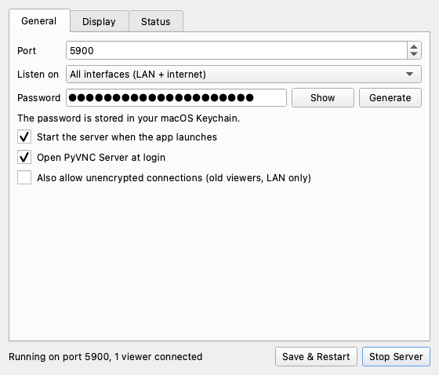
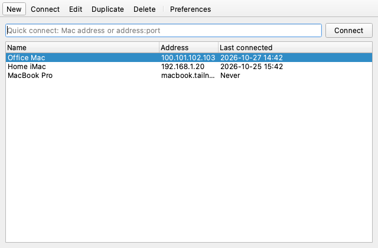

# PyVNC: control your Mac from a Windows PC

There are two apps, both written in Python with PyQt6:

- **PyVNC Server** runs on the Mac, in the menu bar.
- **PyVNC Viewer** runs on Windows.

They speak the standard VNC (RFB 3.8) protocol, encrypted with TLS, so each side also works
with stock VNC tools.

| Mac: PyVNC Server | Windows: PyVNC Viewer |
| --- | --- |
|  |  |

Features:

- **Encrypted by default:** TLS 1.2+ with a self-signed certificate that the viewer pins on
  first connect. The password is checked inside the TLS tunnel. Repeated wrong passwords
  from one IP are blocked for 15 minutes.
- **Bandwidth-friendly:** only the parts of the screen that changed are sent (64x64 tiles).
  Encodings are JPEG (Tight), Zlib, and Raw. The frame rate and quality are adjustable.
- **Full control:** mouse, keyboard, scroll, and clipboard both ways. Ctrl works as the
  Command key, and the viewer has a "Send keys" menu for Mac shortcuts.

---

## 1. Mac: PyVNC Server

### Install

To build the app yourself:

```bash
scripts/build_mac_app.sh          # creates dist/PyVNC Server.app
scripts/build_mac_app.sh --dmg    # also creates dist/PyVNC-Server.dmg
```

Drag **PyVNC Server.app** into Applications. The first time you open it, right-click it and
choose **Open**: the app is ad-hoc signed, not notarized by Apple.

To run it from source without building:

```bash
python3 -m venv .venv && .venv/bin/pip install -r requirements-server.txt
.venv/bin/python -m server.app
```

### First-time setup

1. The settings window opens. On the **General** tab, set a password, or click
   **Generate**. It is stored in your macOS Keychain.
2. If a yellow banner appears, click its buttons and enable **PyVNC Server** in System
   Settings > Privacy & Security under:
   - **Screen Recording**: without it, viewers only see the wallpaper.
   - **Accessibility**: without it, the mouse and keyboard don't work.

   Then quit and reopen the app. When running from source, grant these to Terminal or
   Python instead.
3. Click **Start Server**. The menu bar icon fills in while the server is running, and
   shows a dot while a viewer is connected.

### Settings window

- **General:** port, which network to listen on (all interfaces, Tailscale only, or this
  Mac only), password, start the server when the app launches, open the app at login.
- **Display:** which monitor to share, resolution (100/75/50%), max frame rate, JPEG
  quality, view-only mode, Ctrl/Cmd swap for third-party viewers, clipboard sharing, keep
  the Mac awake.
- **Status:** the addresses to connect to, the certificate fingerprint (with Copy and
  Regenerate), connected viewers (with a Disconnect button), and a live log.

Click **Save** to store your changes. While the server is running the button reads
**Save & Restart**, which saves and restarts it in one step. The menu bar icon's menu has
Start/Stop, Settings, Copy Fingerprint, and Quit.

---

## 2. Windows: PyVNC Viewer

### Install

Build it on a Windows PC with Python 3.11 or newer:

```bat
scripts\build_client_windows.bat               :: dist\PyVNC Viewer\PyVNC Viewer.exe
scripts\build_client_windows.bat --installer   :: also dist\PyVNCViewer-Setup.exe
```

The `--installer` option needs [Inno Setup 6](https://jrsoftware.org/isinfo.php). The
installer adds a Start Menu entry, an optional desktop shortcut, and an uninstaller. It
doesn't need admin rights.

To run it from source:

```bat
py -3 -m venv .venv
.venv\Scripts\pip install -r requirements-client.txt
.venv\Scripts\python -m client.main
```

### Using the viewer

- **Saved connections:** click **New** to add your Mac with a name, address, port,
  password, and quality. Double-click a connection to open it.
  - Tick **Remember password** to save it in Windows Credential Manager. Passwords are
    never written to the connections file (`%APPDATA%\PyVNC\connections.json`).
  - The right-click menu has Connect, Edit, Duplicate, Delete, and Forget trusted
    certificate.
- **Quick connect:** type `address` or `address:port` at the top and press Enter. The
  connection is saved to the list automatically.
- **First connection:** the viewer shows the server's certificate fingerprint. Compare it
  with **Status > Certificate fingerprint** in PyVNC Server on the Mac, then click **Yes**.
  If the fingerprint ever changes, the viewer warns you before continuing.
- **Several Macs at once:** every connection opens its own window.
- **Viewer toolbar:**
  - **Scale:** Fit, 100%, 75%, or 50%.
  - **Full screen**
  - **Send keys:** Cmd+Tab, Spotlight, Force Quit, Mission Control, lock screen, and so on.
  - **Ctrl = Command:** on by default. Ctrl+C, Ctrl+V, and so on work as expected on the
    Mac, and the Windows key becomes Control. Alt is the Mac Option key.
  - **Screenshot...:** saves the remote screen as a PNG.
  - **Disconnect**
- **Dropped connections:** if a connection drops, the viewer offers to reconnect.
- **Preferences:** the default quality for new connections, and the theme (follow system,
  light, or dark).

---

## 3. Connecting over the internet

### Option A: Tailscale (recommended)

1. Install [Tailscale](https://tailscale.com/download) on the Mac and the PC, and sign in
   to the same account on both.
2. On the Mac, the **Status** tab of PyVNC Server lists the Mac's Tailscale address
   (`100.x.y.z`).
3. Connect the viewer to that address.

This needs no router changes and no open ports, and it works behind any NAT. For extra
lockdown, set **Listen on: Tailscale only**.

### Option B: router port forwarding

1. Give the Mac a fixed LAN IP, either with a DHCP reservation or a manual IP.
2. On the router, forward a TCP port to the Mac's IP on port 5900. A non-standard external
   port such as 45900 cuts down on scanner noise.
3. If your home IP changes, set up dynamic DNS (DuckDNS, No-IP, and so on).
4. If the macOS firewall is on, allow incoming connections for PyVNC Server.

When the port is exposed like this, use a long random password (use **Generate**), and
never enable "Allow unencrypted connections".

---

## Advanced: command-line server

The server also runs headless, without the app:

```bash
.venv/bin/python -m server.main --help
.venv/bin/python -m server.main --port 5901 --scale 0.5 --fps 15
scripts/install_launch_agent.sh        # start the CLI server at login (password in ~/.pyvnc/password)
```

| Option | Purpose |
| --- | --- |
| `--port 5901` | Use this port if macOS Screen Sharing already owns 5900 |
| `--scale 0.5` | Halve the resolution on slow links |
| `--fps 10` | Lower CPU use and bandwidth |
| `--quality 40` | Force a JPEG quality (1-95), overriding the viewer's setting |
| `--display 2` | Share a second monitor |
| `--swap-ctrl-cmd` | Ctrl acts as Command, for stock viewers |
| `--view-only` | Watch only, no input |
| `--password-file F` | Read the password from a file |
| `--insecure-allow-plain` | Also offer unencrypted VNC auth (LAN testing only) |

## Project layout

```
common/    protocol + TLS/auth helpers (shared)
server/    controller.py (server engine), app.py (menu bar app), main.py (CLI), capture/encoder/input/clipboard
client/    main.py (entry), launcher.py (connections UI), viewer.py (remote window), view.py, connection.py, store.py
scripts/   build_mac_app.sh, build_client_windows.bat, installer.iss, make_icons.py, install_launch_agent.sh
assets/    app icons (regenerate with: python scripts/make_icons.py)
tests/     smoke_test.py
```

## Testing

```bash
.venv/bin/python -m tests.smoke_test
```

This runs on the Mac. It checks the CLI server and the in-process `ServerController`
against the headless client: TLS, JPEG and Zlib encodings, wrong-password rejection,
disconnecting a viewer, restart, and port-conflict errors.

## Troubleshooting

| Symptom | Fix |
| --- | --- |
| Viewer shows only the wallpaper | Grant Screen Recording to PyVNC Server, then reopen the app |
| Mouse and keyboard do nothing | Grant Accessibility, then reopen the app |
| "Port 5900 is already in use" | Turn off System Settings > General > Sharing > Screen Sharing, or change the port |
| Can't connect over the internet | Check Tailscale is connected on both machines, or check the port-forward and firewall |
| Laggy | Viewer: pick Low quality. Server: Display tab, 50% resolution and a lower frame rate |
| "Certificate has CHANGED" | Expected after Regenerate certificate on the Mac; otherwise don't connect |
| Permissions keep resetting after rebuilding the app | Each rebuild gets a new ad-hoc signature: remove the old entry in Privacy & Security and grant again |
